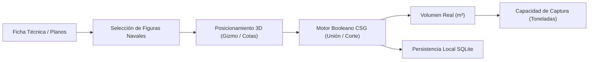

# 01. Planteo Inicial y Objetivos

## 1. Contexto y Problemática

En la actividad pesquera industrial y de investigación náutica (como la desarrollada por observadores a bordo y peritos navales), la determinación precisa de la capacidad de almacenamiento de los pozos y bodegas de los buques es fundamental para:
- Cuantificar capturas por especie en volumen ($m^3$) y masa (toneladas).
- Fiscalizar cupos de pesca y límites biológicamente aceptables.
- Validar la estabilidad y estiba del buque durante la marea.

Históricamente, los pozos de pesca no son prismas rectangulares perfectos:
- Tienen fondos inclinados con pendientes o rampas hacia las compuertas de descarga.
- Presentan pantoques, quillas de balance y formas trapezoidales adaptadas a las cuadernas del casco.
- Poseen túneles de tuberías, columnas estructurales cilíndricas, cajas de cadenas o mamparos que sustraen volumen utilizable.

### Limitaciones del Enfoque Tradicional
1. **Cálculos manuales en papel:** Se recurría a planillas estáticas donde se sumaban o restaban fórmulas analíticas aisladas.
2. **Ignorancia de las intersecciones espaciales:** Si una cuña o conducto se superponía con otro elemento, la suma algebraica duplicaba o restaba erróneamente volúmenes comunes.
3. **Falta de retroalimentación visual:** Resultaba casi imposible detectar si una figura estaba mal orientada, invertida o penetrando mamparos exteriores.
4. **Falta de conectividad en alta mar:** Las herramientas en la nube son inviables debido a la ausencia de conexión a internet durante las campañas de pesca.

---

## 2. Objetivos del Sistema

El objetivo central del proyecto fue desarrollar una **Aplicación Web Progresiva (PWA) 100% Offline** para modelar en 3D los pozos de pesca y calcular automáticamente su volumen y capacidad de carga.

### Objetivos Específicos
1. **Catálogo Paramétrico Naval:** Disponer de las 10 geometrías canónicas empleadas en ingeniería naval pesquera.
2. **Entorno Gráfico 3D Intuitivo:** Manipulación mediante gizmos, snapping inteligente a cuadrícula y alineación entre caras de bloques.
3. **Cálculo Riguroso por Intersección Espacial:** Computar el volumen del sólido resultante mediante operaciones booleanas reales (CSG), de modo que si un elemento sustractivo flota o penetra parcialmente, solo se descuente el volumen de la intersección exacta.
4. **Operación Totalmente Desconectada (Offline-First):** Base de datos relacional SQLite completa embebida en el cliente (WASM + IndexedDB), con exportación e importación directa de archivos `.sqlite`.
5. **Terminología y Orientación Náutica:** Ejes y cámaras adaptados al vocabulario marítimo: Eslora (Proa-Popa), Manga (Babor-Estribor) y Puntal (Piso-Techo).
