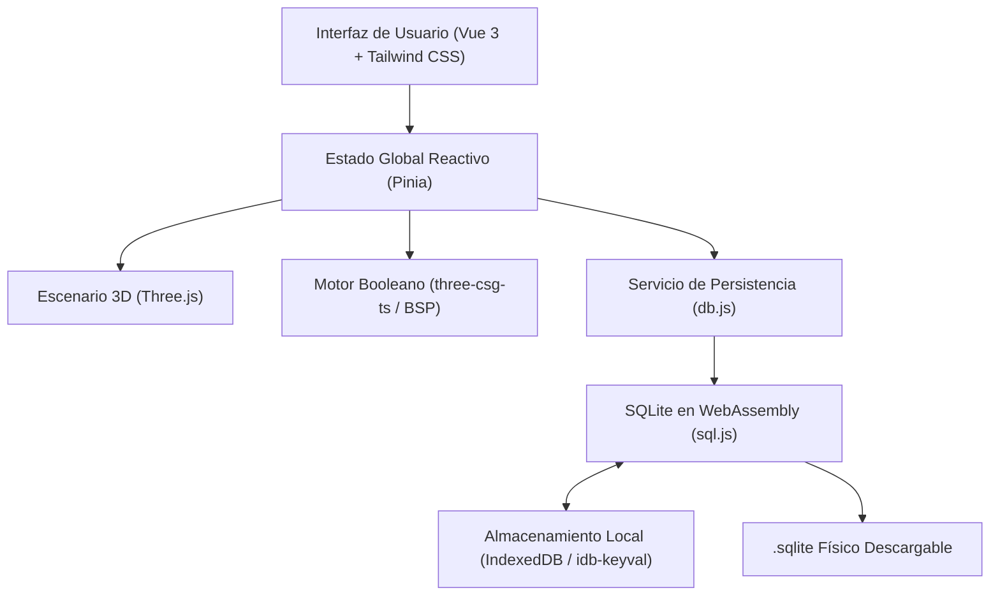

# 02. Arquitectura y Stack Tecnológico

## 1. Filosofía de Diseño: Cliente Autónomo (Offline-First)

La aplicación fue concebida con una arquitectura **Serverless / Client-Side 100%**:
- Todo el código se ejecuta en el navegador web del usuario (laptop, tablet o PC de a bordo).
- No requiere backend, ni base de datos remota, ni autenticación de red para funcionar.
- Se distribuye como una **Progressive Web App (PWA)**, permitiendo instalarse en el sistema operativo y funcionar sin conexión.



---

## 2. Stack Tecnológico

| Componente | Tecnología | Versión | Rol en el Sistema |
| :--- | :--- | :--- | :--- |
| **Framework UI** | Vue.js | `^3.5.13` | Componentes reactivos con Composition API (`<script setup>`). |
| **Estado Global** | Pinia | `^3.0.1` | Gestión reactiva de buques, pozos, bloques seleccionados y volúmenes. |
| **Motor 3D** | Three.js | `^0.174.0` | Renderizado WebGL, iluminación, cámaras, mallas y `TransformControls`. |
| **Motor Booleano** | `three-csg-ts` | `^3.2.0` | Algoritmo de partición binaria del espacio (BSP) para uniones y cortes. |
| **Base de Datos** | `sql.js` (SQLite WASM) | `^1.12.0` | Motor relacional completo ejecutado en memoria WebAssembly. |
| **Persistencia Local**| `idb-keyval` | `^6.2.1` | Almacenamiento asíncrono del binario SQLite en IndexedDB del navegador. |
| **Estilos y Diseño** | Tailwind CSS | `^3.4.17` | Interfaz oscura profesional con paleta naval/náutica. |
| **Iconografía** | Lucide Vue Next | `^0.475.0` | Iconos náuticos, geométricos y de controles. |
| **Bundler y PWA** | Vite + `vite-plugin-pwa` | Vite 6 | Compilación ultrarrápida, Service Worker y manifiesto PWA. |

---

## 3. Esquema de Base de Datos Relacional (SQLite)

La persistencia en `src/services/db.js` estructura la información en tres tablas normalizadas con claves foráneas:

```sql
-- Buques pesqueros
CREATE TABLE IF NOT EXISTS buques (
    id INTEGER PRIMARY KEY AUTOINCREMENT,
    nombre TEXT NOT NULL,
    matricula TEXT NOT NULL UNIQUE,
    eslora REAL,
    manga REAL,
    puntal REAL,
    tipo_buque TEXT,
    creado_en DATETIME DEFAULT CURRENT_TIMESTAMP
);

-- Pozos de almacenamiento o bodegas
CREATE TABLE IF NOT EXISTS pozos (
    id INTEGER PRIMARY KEY AUTOINCREMENT,
    buque_id INTEGER NOT NULL,
    nombre TEXT NOT NULL,
    volumen_total REAL DEFAULT 0,
    densidad_estiba REAL DEFAULT 800, -- kg/m³
    notas TEXT,
    FOREIGN KEY (buque_id) REFERENCES buques(id) ON DELETE CASCADE
);

-- Bloques geométricos paramétricos que componen el pozo
CREATE TABLE IF NOT EXISTS bloques (
    id INTEGER PRIMARY KEY,
    pozo_id INTEGER NOT NULL,
    orden INTEGER NOT NULL,
    nombre TEXT NOT NULL,
    tipo_figura TEXT NOT NULL,       -- ej: 'caja', 'cuna_regular', etc.
    operacion TEXT DEFAULT 'UNION',  -- 'UNION' (+) o 'SUBSTRACCION' (-)
    largo REAL DEFAULT 0,
    ancho REAL DEFAULT 0,
    alto REAL DEFAULT 0,
    base_a REAL DEFAULT 0,
    base_b REAL DEFAULT 0,
    diametro_d REAL DEFAULT 0,
    diametro_d_menor REAL DEFAULT 0,
    pos_x REAL DEFAULT 0,
    pos_y REAL DEFAULT 0,
    pos_z REAL DEFAULT 0,
    rot_x REAL DEFAULT 0,
    rot_y REAL DEFAULT 0,
    rot_z REAL DEFAULT 0,
    volumen_individual REAL DEFAULT 0,
    FOREIGN KEY (pozo_id) REFERENCES pozos(id) ON DELETE CASCADE
);
```

---

## 4. Estructura de Directorios

```
Cubicacion/
├── docs/                      # Documentación técnica completa
├── public/                    # Iconos y manifiesto PWA
├── src/
│   ├── assets/                # Estilos globales y fuentes
│   ├── components/
│   │   ├── BlockCatalog.vue   # Paleta lateral de las 10 figuras navales
│   │   ├── PropertiesPanel.vue# Inspector de parámetros, cotas y componentes
│   │   ├── Toolbar.vue        # Barra métrica de volumen, captura y modos
│   │   └── Viewport3D.vue     # Escenario Three.js, cámaras y gizmos
│   ├── services/
│   │   ├── csgService.js      # Operaciones booleanas BSP y cálculo de volumen
│   │   ├── db.js              # Inicialización SQLite WASM y persistencia IDB
│   │   └── geometryCatalog.js # Las 10 figuras navales, fórmulas y mallas
│   ├── stores/
│   │   └── editorStore.js     # Estado Pinia con reactividad y undo/redo
│   ├── App.vue                # Componente raíz
│   └── main.js                # Entrada Vite
├── package.json
└── vite.config.js
```
