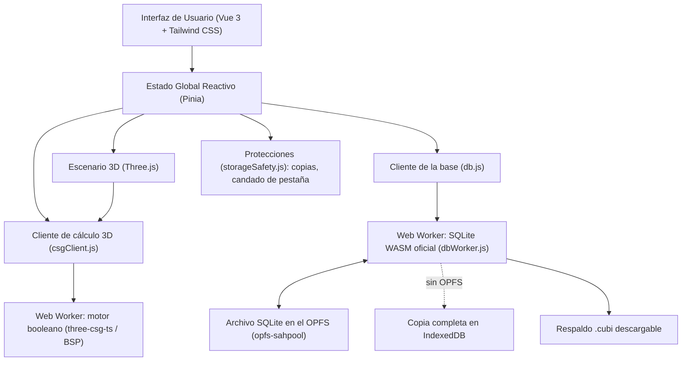

# 02. Arquitectura y Stack Tecnológico

## 1. Filosofía de Diseño: Cliente Autónomo (Offline-First)

La aplicación fue concebida con una arquitectura **Serverless / Client-Side 100%**:
- Todo el código se ejecuta en el navegador web del usuario (laptop, tablet o PC de a bordo).
- No requiere backend, ni base de datos remota, ni autenticación de red para funcionar.
- Se distribuye como una **Progressive Web App (PWA)**, que se puede instalar en el sistema operativo y funciona sin conexión.



---

## 2. Stack Tecnológico

| Componente | Tecnología | Versión | Rol en el Sistema |
| :--- | :--- | :--- | :--- |
| **Framework UI** | Vue.js | `^3.5.13` | Componentes reactivos con Composition API (`<script setup>`). |
| **Estado Global** | Pinia | `^3.0.1` | Gestión reactiva de buques, pozos, bloques seleccionados, volúmenes e historial. |
| **Motor 3D** | Three.js | `^0.174.0` | Renderizado WebGL, iluminación, cámaras, mallas y `TransformControls`. |
| **Motor Booleano** | `three-csg-ts` | `^3.2.0` | Partición binaria del espacio (BSP) para uniones y cortes, ejecutado en un Web Worker. |
| **Base de Datos** | `@sqlite.org/sqlite-wasm` | `^3.54.1-build1` | SQLite oficial compilado a WebAssembly, en un Web Worker. |
| **Persistencia Local**| OPFS (VFS `opfs-sahpool`) | — | Archivo SQLite real en el almacenamiento privado del origen; escrituras por páginas con journal. |
| **Copias y respaldo** | `idb-keyval` | `^6.2.1` | Copias automáticas en IndexedDB y, en navegadores sin OPFS, la base completa. |
| **Estilos y Diseño** | Tailwind CSS | `^3.4.17` | Interfaz oscura con paleta naval. |
| **Iconografía** | Lucide Vue Next | `^0.475.0` | Iconos de la interfaz. |
| **Bundler y PWA** | Vite + `vite-plugin-pwa` | Vite 6 | Compilación, Service Worker, manifiesto e íconos de la PWA. |
| **Pruebas** | `node:test` | Node 18+ | Pruebas de fórmulas, mallas, motor booleano y migraciones (`npm test`). |

---

## 3. Esquema de Base de Datos (SQLite)

El esquema se define en `src/services/schema.js`. Las claves foráneas se activan en cada conexión (`PRAGMA foreign_keys = ON`), por lo que el borrado en cascada se aplica.

```sql
-- Buques pesqueros
CREATE TABLE IF NOT EXISTS buques (
    id INTEGER PRIMARY KEY AUTOINCREMENT,
    nombre TEXT NOT NULL,
    matricula TEXT,  -- opcional, sin uso en la interfaz
    armador TEXT,    -- opcional, sin uso en la interfaz
    densidad_estiba REAL DEFAULT 800.0, -- factor de captura del buque (kg/m³)
    creado_en DATETIME DEFAULT CURRENT_TIMESTAMP
);

-- Pozos de almacenamiento o bodegas
CREATE TABLE IF NOT EXISTS pozos (
    id INTEGER PRIMARY KEY AUTOINCREMENT,
    buque_id INTEGER NOT NULL,
    nombre TEXT NOT NULL,
    volumen_total REAL DEFAULT 0.0,   -- último volumen calculado (m³)
    densidad_estiba REAL DEFAULT 800.0, -- sin uso desde v2 (ver buques)
    notas TEXT,
    FOREIGN KEY (buque_id) REFERENCES buques (id) ON DELETE CASCADE
);

-- Bloques geométricos paramétricos que componen el pozo
CREATE TABLE IF NOT EXISTS bloques (
    id INTEGER PRIMARY KEY AUTOINCREMENT,
    pozo_id INTEGER NOT NULL,
    orden INTEGER NOT NULL,
    nombre TEXT NOT NULL,
    tipo_figura TEXT NOT NULL,   -- 'caja', 'cuna_regular', 'trapezoide', …
    operacion TEXT NOT NULL,     -- 'UNION' (+) o 'SUBSTRACCION' (-)
    largo REAL DEFAULT 5.0,
    ancho REAL DEFAULT 4.0,
    alto REAL DEFAULT 3.0,
    base_a REAL DEFAULT 4.0,
    base_b REAL DEFAULT 2.0,
    diametro_d REAL DEFAULT 2.0,
    diametro_d_menor REAL DEFAULT 1.0,
    pos_x REAL DEFAULT 0, pos_y REAL DEFAULT 0, pos_z REAL DEFAULT 0,  -- metros; pos_y = piso de la pieza
    rot_x REAL DEFAULT 0, rot_y REAL DEFAULT 0, rot_z REAL DEFAULT 0,  -- radianes
    volumen_individual REAL DEFAULT 0.0,
    fijada INTEGER DEFAULT 0,     -- 1: no se puede mover ni cambiar sus medidas
    desvio_largo REAL DEFAULT 0,  -- piramidal: corrimiento del vértice
    desvio_ancho REAL DEFAULT 0,
    FOREIGN KEY (pozo_id) REFERENCES pozos (id) ON DELETE CASCADE
);
```

### Versionado y migraciones
- La versión del esquema se guarda en `PRAGMA user_version` (`src/services/migrations.js`). Las bases anteriores a este mecanismo tienen versión 0.
- Los respaldos `.cubi` son la base SQLite completa con la firma `PRAGMA application_id = 0x43554249` ("CUBI"). Para inspeccionar uno con herramientas de SQLite alcanza con renombrarlo. Al restaurar un archivo (`src/services/respaldo.js`) se exige la firma, se comprueba la integridad (`quick_check`) y se aplican las migraciones. Las copias internas no exigen firma.
- Cada migración nueva necesita su paso inverso en `tests/respaldo.test.js`, que prueba la restauración desde todas las versiones anteriores.
- Al abrir o importar una base se valida que tenga las tablas y columnas de la aplicación, se guarda una copia y se aplican las migraciones pendientes dentro de una transacción.
- **v1:** los trapezoides pasaron a tener el largo sobre X (se compensa su rotación) y cada pozo se apoya en `y = 0` moviendo todas sus piezas juntas, sin cambiar el volumen.
- **v2:** el factor de captura pasa a ser del buque; se toma el que tenía su primer pozo.
- **v3:** las piezas tienen la columna `fijada`.
- **v4:** columnas `desvio_largo` y `desvio_ancho` (corrimiento del vértice de la piramidal; 0 en las piezas anteriores).
- **v5:** tabla `cotas` (`pozo_id`, dos puntos `ax…bz` en coordenadas de la bodega y `eje`), para las cotas puestas con la herramienta Medir.
- Una base de una versión más nueva de la aplicación se rechaza, para no dañarla.

---

## 4. Persistencia y Protección de los Datos

### Almacenamiento
La base vive en un **Web Worker** (`src/workers/dbWorker.js`) con el SQLite oficial en WebAssembly. El hilo principal la usa a través de `src/services/db.js`, con operaciones asíncronas (`query`, `run`, `batch` en una transacción, `export`, `replace`).

- **Modo principal: archivo SQLite en el OPFS** (Origin Private File System) con el VFS `opfs-sahpool`. Cada cambio se escribe por páginas, con el journal de SQLite, sin reescribir la base entera. No requiere cabeceras COOP/COEP en el servidor. Navegadores: Chrome/Edge 108+, Safari 16.4+, Firefox 111+.
- **Modo compatible:** si el navegador no admite OPFS en workers, la base vive en memoria y su copia completa se guarda en IndexedDB después de cada escritura. El menú de respaldos indica qué modo está en uso.
- **Paso desde la versión anterior:** la primera vez, la base que estaba en IndexedDB se valida, se migra de esquema si hace falta y se copia al OPFS. La original queda como copia ("Base anterior al cambio de almacenamiento") y se borra de su ubicación vieja.
- El VFS se instala con `preserveOnInitFailure`: sin esa opción, un fallo de inicialización (por ejemplo, si otra pestaña todavía no soltó los archivos) **borraría todo el almacenamiento**.
- El esquema y las migraciones usan un adaptador (`src/services/sqliteCompat.js`), así que las pruebas en Node ejercitan el mismo motor que la app.

### Protecciones

| Riesgo | Protección |
| :--- | :--- |
| El navegador borra los datos por falta de espacio o inactividad | Se pide almacenamiento persistente (`navigator.storage.persist`). Instalar la app como PWA ayuda a que se conceda. |
| Cerrar la pestaña con cambios sin guardar | Se guarda lo pendiente al ocultar o cerrar la pestaña (`visibilitychange` / `pagehide`). |
| Dos pestañas pisándose los datos | Candado de pestaña única con la Web Locks API: la segunda pestaña puede tomar el control; la primera cierra la base y suelta los archivos del OPFS. |
| Cerrar la app a mitad de un guardado | Las piezas de un pozo se guardan en una sola transacción; con OPFS, el journal de SQLite deja la base en el estado anterior o en el nuevo, nunca a medias. |
| Un error que daña la base | Copias automáticas dentro del navegador: una diaria y otra antes de migrar, importar o restaurar (se conservan las últimas 10). |
| Pérdida del equipo o del navegador | Exportación a un respaldo `.cubi` y restauración desde el menú de respaldos; aviso si pasan 7 días sin exportar. |

> Las copias automáticas viven en el mismo navegador que la base. El único respaldo independiente es el archivo `.cubi` exportado.

---

## 5. Cálculo del Volumen en Segundo Plano

El motor booleano puede tardar cientos de milisegundos con muchas piezas, así que corre en un **Web Worker** (`src/workers/csgWorker.js`) y la interfaz no se congela:

- `src/services/csgClient.js` es el único punto de acceso. Guarda en caché los últimos resultados por forma de las piezas (el nombre no cuenta), de modo que el volumen y el modo "Vista previa" comparten el mismo cálculo.
- Procesa un cálculo a la vez y, si llegan varios pedidos mientras tanto, solo el último.
- El worker devuelve la geometría en coordenadas del mundo, con transferencia de buffers.
- Si el navegador no admite workers de módulo, el cálculo se hace en el hilo principal.

Mientras no hay resultado, la barra superior muestra **"Calculando…"**; si el cálculo falla, muestra **"⚠ Aproximado"** con la causa.

---

## 6. Diseño Adaptable y Actualizaciones

- `src/services/layout.js` expone el tamaño de pantalla (`isPhone` < 768 px, `isCompact` < 1280 px, `isWide` ≥ 1536 px, `isTouch`, `isShort`) y el panel abierto en modo compacto. Los componentes deciden su disposición a partir de esos valores.
- En modo compacto, `PanelSheet` muestra la paleta, la lista de piezas, el editor o el menú "Más" sobre el visor, como hoja inferior (teléfono vertical) o cajón lateral.
- La selección en el visor se hace con un toque o clic corto (menos de 8 px y 600 ms); un arrastre orbita sin cambiar la selección.
- `src/services/pwaUpdate.js` registra el service worker en modo `prompt` y aplica las versiones nuevas en un momento de reposo, después de guardar. Al arrancar, la app reintenta durante unos 2 s tomar el candado de pestaña, porque la página anterior puede tardar en soltarlo al recargar.

---

## 7. Estructura de Directorios

```
cubicador/
├── docs/                        # Documentación técnica
├── public/                      # Íconos de la PWA (generados por scripts/generar-iconos.mjs)
├── scripts/
│   ├── capturas-manual.mjs      # npm run capturas
│   ├── generar-iconos.mjs       # npm run icons
│   └── manual-pdf/              # npm run manual:pdf (generador, estilos y huella)
├── src/
│   ├── components/
│   │   ├── AppDialog.vue        # Diálogos de confirmación y avisos
│   │   ├── AppVersion.vue       # Versión y fecha de compilación
│   │   ├── BackupsPanel.vue     # Exportar/restaurar y copias automáticas
│   │   ├── BottomNav.vue        # Barra inferior del modo compacto
│   │   ├── DimensionOverlay.vue # Cotas dibujadas sobre el visor (SVG)
│   │   ├── ExportImageDialog.vue # Elegir el fondo antes de exportar el PNG
│   │   ├── FactorCalculator.vue # Factor de captura a partir de kg y m³
│   │   ├── MeasurePanel.vue     # Panel de la herramienta Medir
│   │   ├── ModelModeToggle.vue  # Edición / Vista previa
│   │   ├── MoreMenu.vue         # Menú "Más" del modo compacto
│   │   ├── PanelSheet.vue       # Panel deslizable (hoja inferior o cajón lateral)
│   │   ├── BlockCatalog.vue     # Paleta lateral de las 10 figuras navales
│   │   ├── RecordForm.vue       # Alta, edición y baja de buques y pozos
│   │   ├── PropertiesPanel.vue  # Inspector de parámetros, cotas y componentes
│   │   ├── Toolbar.vue          # Volumen, captura, modos, respaldos e instalación
│   │   └── Viewport3D.vue       # Escenario Three.js, cámaras y gizmos
│   ├── services/
│   │   ├── csgClient.js         # Acceso al cálculo 3D (worker + caché)
│   │   ├── csgCompute.js        # Cálculo booleano como datos transferibles
│   │   ├── csgService.js        # Operaciones booleanas BSP, volumen y snap
│   │   ├── db.js                # Cliente de la base (worker), importación y exportación
│   │   ├── dialog.js            # API de los diálogos (confirmDialog, promptDialog…)
│   │   ├── dimensions.js        # Cotas automáticas, cotas a mano e imán de Medir
│   │   ├── exportImage.js       # Colores, dibujo de cotas y descarga del PNG
│   │   ├── factor.js            # Cálculo del factor de captura (t/m³)
│   │   ├── geometryCatalog.js   # Las 10 figuras navales, fórmulas y mallas
│   │   ├── install.js           # Instalación de la PWA
│   │   ├── layout.js            # Tamaño de pantalla y panel abierto (diseño adaptable)
│   │   ├── pwaUpdate.js         # Actualización automática de la app
│   │   ├── respaldo.js          # Archivos .cubi: firma, comprobaciones y actualización
│   │   ├── migrations.js        # Validación y versionado del esquema
│   │   ├── schema.js            # Tablas y datos de ejemplo
│   │   ├── slug.js              # Anclas del manual, compartidas con el PDF
│   │   ├── stretch.js           # Modo Estirar: tiradores por figura, imán y medidas
│   │   ├── sqliteCompat.js      # Adaptador del motor para el esquema y las migraciones
│   │   └── storageSafety.js     # Persistencia, candado de pestaña y copias
│   ├── stores/
│   │   └── editorStore.js       # Estado Pinia, historial y guardado
│   ├── workers/
│   │   ├── csgWorker.js         # Web Worker del cálculo 3D
│   │   └── dbWorker.js          # Web Worker de la base (SQLite + OPFS)
│   ├── App.vue                  # Componente raíz
│   └── main.js                  # Entrada Vite
├── tests/                       # npm test
├── package.json
└── vite.config.js
```

---

## 8. Publicación

### PDF del manual
- `docs/manual-de-usuario.pdf` se genera con `npm run manual:pdf` desde `docs/06-manual-de-usuario.md`, con Chrome o Edge instalados (131 o posterior). La app lo ofrece en el botón **PDF** del manual y lo guarda para usarlo sin conexión.
- Junto a él, `manual-de-usuario.pdf.json` guarda la huella del texto, las imágenes, el maquetado y la versión. `npm test` falla si algo cambió sin regenerar el PDF.
- Orden al cambiar la interfaz: `npm run capturas`, `npm run manual:pdf`, `npm test`.
- `npm test` también revisa el maquetado leyendo el PDF con `pdfjs-dist` (`scripts/manual-pdf/revisar.mjs`): capítulos en página nueva, páginas casi vacías, títulos al pie, márgenes, tamaño del texto, encabezado y numeración, enlaces del índice y marcadores.
- Para probar un cambio de estilos sin tocar el PDF publicado: `node scripts/manual-pdf/generar.mjs salida.pdf`.
- La prueba no juzga la estética ni la legibilidad de las capturas: conviene mirar el PDF después de cambios grandes.

- `npm run build` genera la app en `dist/`, lista para cualquier hosting estático.
- Para publicarla en un subdirectorio (por ejemplo `https://servidor/cubicador/`), definir la ruta base al compilar. En PowerShell:

  ```powershell
  $env:BASE_PATH = '/cubicador/'; npm run build
  ```

  Las rutas de los `.wasm`, de los workers, del service worker y del manifiesto se ajustan solas.
- El servidor debe servir los `.wasm` con el tipo `application/wasm` (los hostings estáticos habituales ya lo hacen). No hacen falta cabeceras COOP/COEP.
