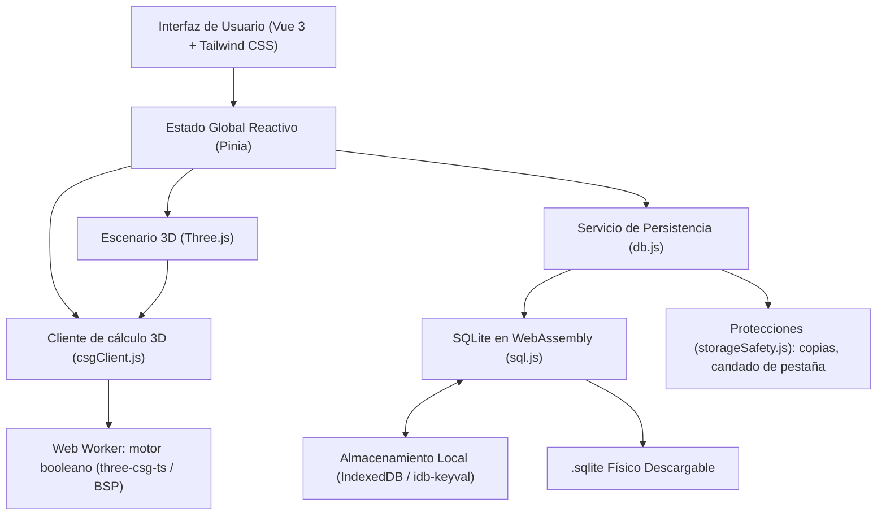

# 02. Arquitectura y Stack Tecnológico

## 1. Filosofía de Diseño: Cliente Autónomo (Offline-First)

La aplicación fue concebida con una arquitectura **Serverless / Client-Side 100%**:
- Todo el código se ejecuta en el navegador web del usuario (laptop, tablet o PC de a bordo).
- No requiere backend, ni base de datos remota, ni autenticación de red para funcionar.
- Se distribuye como una **Progressive Web App (PWA)**, que se puede instalar en el sistema operativo y funciona sin conexión.



---

## 2. Stack Tecnológico

| Componente | Tecnología | Versión | Rol en el Sistema |
| :--- | :--- | :--- | :--- |
| **Framework UI** | Vue.js | `^3.5.13` | Componentes reactivos con Composition API (`<script setup>`). |
| **Estado Global** | Pinia | `^3.0.1` | Gestión reactiva de buques, pozos, bloques seleccionados, volúmenes e historial. |
| **Motor 3D** | Three.js | `^0.174.0` | Renderizado WebGL, iluminación, cámaras, mallas y `TransformControls`. |
| **Motor Booleano** | `three-csg-ts` | `^3.2.0` | Partición binaria del espacio (BSP) para uniones y cortes, ejecutado en un Web Worker. |
| **Base de Datos** | `sql.js` (SQLite WASM) | `^1.12.0` (instalada 1.17) | Motor relacional completo en WebAssembly, importado como módulo. |
| **Persistencia Local**| `idb-keyval` | `^6.2.1` | Almacenamiento del binario SQLite y de las copias automáticas en IndexedDB. |
| **Estilos y Diseño** | Tailwind CSS | `^3.4.17` | Interfaz oscura con paleta naval. |
| **Iconografía** | Lucide Vue Next | `^0.475.0` | Iconos de la interfaz. |
| **Bundler y PWA** | Vite + `vite-plugin-pwa` | Vite 6 | Compilación, Service Worker, manifiesto e íconos de la PWA. |
| **Pruebas** | `node:test` | Node 18+ | Pruebas de fórmulas, mallas, motor booleano y migraciones (`npm test`). |

---

## 3. Esquema de Base de Datos (SQLite)

El esquema se define en `src/services/schema.js`. Las claves foráneas se activan en cada conexión (`PRAGMA foreign_keys = ON`), por lo que el borrado en cascada se aplica.

```sql
-- Buques pesqueros
CREATE TABLE IF NOT EXISTS buques (
    id INTEGER PRIMARY KEY AUTOINCREMENT,
    nombre TEXT NOT NULL,
    matricula TEXT,
    armador TEXT,
    creado_en DATETIME DEFAULT CURRENT_TIMESTAMP
);

-- Pozos de almacenamiento o bodegas
CREATE TABLE IF NOT EXISTS pozos (
    id INTEGER PRIMARY KEY AUTOINCREMENT,
    buque_id INTEGER NOT NULL,
    nombre TEXT NOT NULL,
    volumen_total REAL DEFAULT 0.0,   -- último volumen calculado (m³)
    densidad_estiba REAL DEFAULT 800.0, -- kg/m³
    notas TEXT,
    FOREIGN KEY (buque_id) REFERENCES buques (id) ON DELETE CASCADE
);

-- Bloques geométricos paramétricos que componen el pozo
CREATE TABLE IF NOT EXISTS bloques (
    id INTEGER PRIMARY KEY AUTOINCREMENT,
    pozo_id INTEGER NOT NULL,
    orden INTEGER NOT NULL,
    nombre TEXT NOT NULL,
    tipo_figura TEXT NOT NULL,   -- 'caja', 'cuna_regular', 'trapezoide', …
    operacion TEXT NOT NULL,     -- 'UNION' (+) o 'SUBSTRACCION' (-)
    largo REAL DEFAULT 5.0,
    ancho REAL DEFAULT 4.0,
    alto REAL DEFAULT 3.0,
    base_a REAL DEFAULT 4.0,
    base_b REAL DEFAULT 2.0,
    diametro_d REAL DEFAULT 2.0,
    diametro_d_menor REAL DEFAULT 1.0,
    pos_x REAL DEFAULT 0, pos_y REAL DEFAULT 0, pos_z REAL DEFAULT 0,  -- metros; pos_y = piso de la pieza
    rot_x REAL DEFAULT 0, rot_y REAL DEFAULT 0, rot_z REAL DEFAULT 0,  -- radianes
    volumen_individual REAL DEFAULT 0.0,
    FOREIGN KEY (pozo_id) REFERENCES pozos (id) ON DELETE CASCADE
);
```

### Versionado y migraciones
- La versión del esquema se guarda en `PRAGMA user_version` (`src/services/migrations.js`). Las bases anteriores a este mecanismo tienen versión 0.
- Al abrir o importar una base se valida que tenga las tablas y columnas de la aplicación, se guarda una copia y se aplican las migraciones pendientes dentro de una transacción.
- **v1:** los trapezoides pasaron a tener el largo sobre X (se compensa su rotación) y cada pozo se apoya en `y = 0` moviendo todas sus piezas juntas, sin cambiar el volumen.
- Una base de una versión más nueva de la aplicación se rechaza, para no dañarla.

---

## 4. Persistencia y Protección de los Datos

| Riesgo | Protección |
| :--- | :--- |
| El navegador borra los datos por falta de espacio o inactividad | Se pide almacenamiento persistente (`navigator.storage.persist`). Instalar la app como PWA ayuda a que se conceda. |
| Cerrar la pestaña con cambios sin guardar | Se guarda lo pendiente al ocultar o cerrar la pestaña (`visibilitychange` / `pagehide`). |
| Dos pestañas pisándose los datos | Candado de pestaña única con la Web Locks API: la segunda pestaña puede tomar el control y la primera deja de escribir. |
| Un error que daña la base | Copias automáticas dentro del navegador: una diaria y otra antes de migrar, importar o restaurar (se conservan las últimas 10). |
| Pérdida del equipo o del navegador | Exportación a archivo `.sqlite` e importación desde el menú de respaldos; aviso si pasan 7 días sin exportar. |

> Las copias automáticas viven en el mismo navegador que la base. El único respaldo independiente es el archivo `.sqlite` exportado.

---

## 5. Cálculo del Volumen en Segundo Plano

El motor booleano puede tardar cientos de milisegundos con muchas piezas, así que corre en un **Web Worker** (`src/workers/csgWorker.js`) y la interfaz no se congela:

- `src/services/csgClient.js` es el único punto de acceso. Guarda en caché los últimos resultados por forma de las piezas (el nombre no cuenta), de modo que el volumen y el modo "Pozo Booleano" comparten el mismo cálculo.
- Procesa un cálculo a la vez y, si llegan varios pedidos mientras tanto, solo el último.
- El worker devuelve la geometría en coordenadas del mundo, con transferencia de buffers.
- Si el navegador no admite workers de módulo, el cálculo se hace en el hilo principal.

Mientras no hay resultado, la barra superior muestra **"Calculando…"**; si el cálculo falla, muestra **"⚠ Nominal"** con la causa.

---

## 6. Estructura de Directorios

```
cubicador/
├── docs/                        # Documentación técnica
├── public/                      # Íconos de la PWA (generados por scripts/generar-iconos.mjs)
├── scripts/
│   └── generar-iconos.mjs       # npm run icons
├── src/
│   ├── components/
│   │   ├── AppDialog.vue        # Diálogos de confirmación y avisos
│   │   ├── BlockCatalog.vue     # Paleta lateral de las 10 figuras navales
│   │   ├── PropertiesPanel.vue  # Inspector de parámetros, cotas y componentes
│   │   ├── Toolbar.vue          # Volumen, captura, modos, respaldos e instalación
│   │   └── Viewport3D.vue       # Escenario Three.js, cámaras y gizmos
│   ├── services/
│   │   ├── csgClient.js         # Acceso al cálculo 3D (worker + caché)
│   │   ├── csgCompute.js        # Cálculo booleano como datos transferibles
│   │   ├── csgService.js        # Operaciones booleanas BSP, volumen y snap
│   │   ├── db.js                # SQLite WASM, persistencia, importación y exportación
│   │   ├── dialog.js            # API de los diálogos (confirmDialog, promptDialog…)
│   │   ├── geometryCatalog.js   # Las 10 figuras navales, fórmulas y mallas
│   │   ├── install.js           # Instalación de la PWA
│   │   ├── migrations.js        # Validación y versionado del esquema
│   │   ├── schema.js            # Tablas y datos de ejemplo
│   │   └── storageSafety.js     # Persistencia, candado de pestaña y copias
│   ├── stores/
│   │   └── editorStore.js       # Estado Pinia, historial y guardado
│   ├── workers/
│   │   └── csgWorker.js         # Web Worker del cálculo 3D
│   ├── App.vue                  # Componente raíz
│   └── main.js                  # Entrada Vite
├── tests/                       # npm test
├── package.json
└── vite.config.js
```

---

## 7. Publicación

- `npm run build` genera la app en `dist/`, lista para cualquier hosting estático.
- Para publicarla en un subdirectorio (por ejemplo `https://servidor/cubicador/`), definir la ruta base al compilar. En PowerShell:

  ```powershell
  $env:BASE_PATH = '/cubicador/'; npm run build
  ```

  Las rutas del `.wasm`, del worker, del service worker y del manifiesto se ajustan solas.
