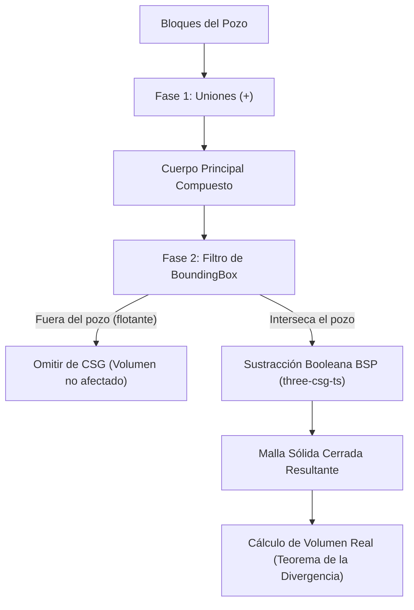

# 04. Motor Booleano CSG y Cálculo Espacial

Uno de los mayores retos técnicos del proyecto fue lograr que las operaciones booleanas (uniones y recortes de figuras dentro de la bodega) fueran 100% estables, precisas y representaran fielmente las intersecciones en el espacio 3D.

---

## 1. El Problema de Coplanaridad en `three-bvh-csg`

Inicialmente se utilizó la librería `three-bvh-csg`. Aunque es rápida, presentó fallos estructurales graves al trabajar con composiciones navales donde varias figuras comparten caras idénticas (como el fondo del pozo $Y=0$, esquinas $X=3$, o mamparos laterales $Z=\pm 2$):

1. **Paredes Fantasma (*Phantom Walls*):** Al recortar una caja sustractiva pegada exactamente a una esquina, el trazado de rayos no lograba clasificar las caras coincidentes y dejaba una fina pared residual en el fondo.
2. **Falla por Inundación (*Half-Edge Flood-Fill*):** En composiciones con cuñas de rampa y figuras flotantes, la clasificación de un triángulo tangencial fallaba, y el algoritmo propagaba erróneamente esa decisión a toda la superficie conectada de la caja principal, **eliminando el techo completo y dejando una cáscara hueca** con el volumen colapsado a valores cercanos a cero.
3. **Inviabilidad de Micro-escalas:** Intentar agrandar artificialmente el cortador (`scale.set(1.008)`) fallaba porque al tener el pivote en la base ($Y=0$), $0 \times 1.008 = 0$, manteniendo la coincidencia coplanar en el piso mientras deformaba las cotas superiores.

---

## 2. Replanteo Arquitectónico: Migración a BSP Clásico (`three-csg-ts`)

Para resolver esto de raíz se reemplazó el motor por **Partición Binaria del Espacio (BSP - Binary Space Partitioning)** mediante `three-csg-ts`:



### Ventajas del Motor BSP:
- **Determinismo Matemático:** Divide los polígonos analíticamente con respecto a planos hiperespaciales sin depender de aproximaciones de rayos.
- **Tolerancia a Caras Coplanares:** Resuelve de manera natural figuras que comparten fondo, esquinas o paredes sin dejar membranas ni agujeros.
- **Estabilidad con Figuras Disjuntas:** Si una figura está en el aire o fuera de la bodega, el sistema descarta la operación en $O(1)$ mediante chequeo de `BoundingBox`, garantizando solidez y rendimiento instantáneo.

---

## 3. Algoritmo de Cálculo de Volumen de Malla 3D

Para calcular el volumen exacto de cualquier geometría combinada (por irregular que sea el recorte resultante), se utiliza el **Teorema de la Divergencia de Gauss** mediante la suma orientada de tetraedros:

$$\text{Volumen} = \frac{1}{6} \left| \sum_{i=1}^{N} \vec{P}_{1,i} \cdot (\vec{P}_{2,i} \times \vec{P}_{3,i}) \right|$$

Donde $\vec{P}_{1,i}, \vec{P}_{2,i}, \vec{P}_{3,i}$ son los tres vértices del triángulo $i$-ésimo de la superficie exterior.

```javascript
export function calculateGeometryVolume(geometry) {
  let geom = geometry.index ? geometry.toNonIndexed() : geometry
  const pos = geom.attributes.position
  let totalVolume = 0

  const p1 = new THREE.Vector3()
  const p2 = new THREE.Vector3()
  const p3 = new THREE.Vector3()

  for (let i = 0; i < pos.count; i += 3) {
    p1.fromBufferAttribute(pos, i)
    p2.fromBufferAttribute(pos, i + 1)
    p3.fromBufferAttribute(pos, i + 2)

    // Producto mixto (determinante de la matriz de vértices) / 6
    const vol = p1.dot(p2.clone().cross(p3)) / 6.0
    totalVolume += vol
  }

  return Math.abs(totalVolume)
}
```

---

## 4. Resolución de Zonas de Intersección Espacial 3D

El cálculo analítico tradicional simplemente sumaba o restaba el volumen nominal de cada pieza:
$$\text{Total Ciego} = \sum V_{\text{uniones}} - \sum V_{\text{sustracciones}}$$

Esto introducía dos errores críticos:
1. Si una figura sustractiva flotaba en el aire o penetraba solo $5\text{ cm}$, le restaba el 100% de su volumen a la bodega.
2. Si dos piezas aditivas se solapaban, sumaba el 100% de ambas duplicando la zona compartida.

**Solución aplicada:** El valor oficial de **Volumen del Pozo** y la **Capacidad de Captura (Ton)** ahora toman reactivamente el **Volumen Real 3D** computado tras resolver las intersecciones booleanas en el espacio. Si existen piezas en el aire o solapadas, la barra superior muestra el valor real y advierte con una etiqueta secundaria el valor nominal ciego.
