# Manual de usuario

**Cubicación 3D de Pozos de Pesca** sirve para calcular el **volumen de un pozo o bodega** de un buque pesquero y la **captura que entra en él**, aunque el pozo tenga una forma irregular: rampas, pantoques, columnas, tuberías o cajones que le quitan espacio.

No hace falta saber de diseño 3D. Este manual explica todo desde cero, con un ejemplo completo que se puede seguir paso a paso.

> **Dónde leer este manual:** dentro de la app, con el botón redondo **?** de la esquina superior derecha del visor, en cualquier pantalla. También con el botón **Manual** de la barra superior (en tablet y teléfono, en **Más → Manual de uso**) o la tecla **F1**.

## Índice

1. [La idea en dos minutos](#1-la-idea-en-dos-minutos)
2. [Primeros pasos](#2-primeros-pasos)
3. [Recorrido por la pantalla](#3-recorrido-por-la-pantalla)
4. [Mirar el pozo: la cámara](#4-mirar-el-pozo-la-cámara)
5. [Buques, pozos y factor de captura](#5-buques-pozos-y-factor-de-captura)
6. [Las figuras disponibles](#6-las-figuras-disponibles)
7. [Trabajar con las piezas](#7-trabajar-con-las-piezas)
8. [Ejemplo guiado: un pozo completo](#8-ejemplo-guiado-un-pozo-completo)
9. [Leer el resultado](#9-leer-el-resultado)
10. [Deshacer y atajos de teclado](#10-deshacer-y-atajos-de-teclado)
11. [Guardar y respaldar los datos](#11-guardar-y-respaldar-los-datos)
12. [Consejos para medir y modelar](#12-consejos-para-medir-y-modelar)
13. [Problemas frecuentes](#13-problemas-frecuentes)
14. [Glosario](#14-glosario)

---

## 1. La idea en dos minutos

### El pozo se arma como un juego de bloques

Ningún pozo real tiene una forma simple. La app propone **armarlo con figuras geométricas sencillas** (cajas, cuñas, cilindros…), como si fueran bloques de un juego de construcción:

- Las piezas que **suman** (+) forman el espacio del pozo.
- Las piezas que **restan** (−) quitan espacio: una columna, una tubería, un cajón de cadenas o el escalón de una rampa.

La app calcula el volumen del **sólido que resulta** de unir y recortar todas las piezas según **dónde están ubicadas**. Si dos piezas que suman se superponen, la parte compartida se cuenta una sola vez. Si una pieza que resta sobresale del pozo, solo se descuenta la parte que está adentro.

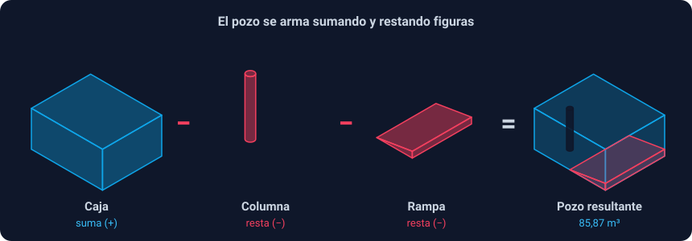

### Qué se obtiene

| Resultado | Unidad | Cómo se calcula |
| :--- | :--- | :--- |
| **Volumen del pozo** | m³ (metros cúbicos) | Volumen real del sólido armado |
| **Captura estimada** | t (toneladas) | Volumen × factor de captura del buque |

### Unidades y decimales

- Todas las medidas son en **metros**. Por ejemplo, 2 metros y 50 centímetros se escribe **2,5**.
- Los decimales se escriben con **coma**. También se acepta el punto, y el punto del teclado numérico escribe una coma.
- Los giros se escriben en **grados**.

### Los ejes: hacia dónde es cada cosa

La app usa la orientación del buque:

| Eje | Color | Significa | Hacia el lado positivo (+) |
| :---: | :---: | :--- | :--- |
| **X** | rojo | **Eslora** (a lo largo del buque) | hacia **proa** |
| **Y** | verde | **Puntal** (altura) | hacia **arriba** |
| **Z** | azul | **Manga** (a lo ancho del buque) | hacia **babor** |

El piso de la cuadrícula es la altura 0. El punto donde se cruzan los ejes es el origen (0, 0, 0): conviene usarlo como referencia del pozo, por ejemplo el centro del piso.

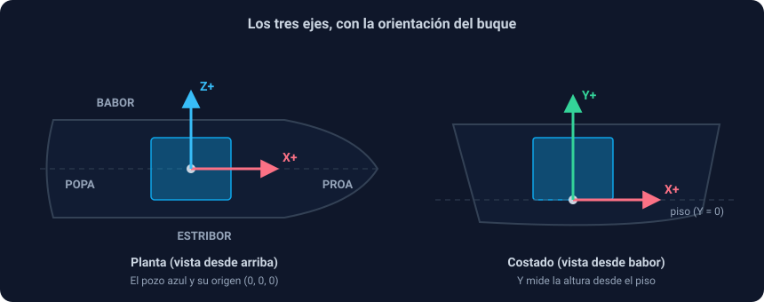

---

## 2. Primeros pasos

### Abrir la app

La app funciona en el navegador (Chrome, Edge, Safari o Firefox actualizados), en computadora, tablet o teléfono. La primera vez carga unos datos de ejemplo: el buque **"Imaginario I"** con el **"Pozo 1 (Popa)"**, que tiene una sola caja de 6 × 5 × 3 m (90 m³). Sirven para probar sin miedo: se pueden editar o borrar.

### Funciona sin internet

Después de abrirla una vez con conexión, la app queda guardada en el dispositivo y **funciona sin internet**, por ejemplo durante una marea. Los datos también se guardan en el dispositivo: no se envían a ningún servidor.

### Instalarla como aplicación (recomendado)

Cuando el navegador lo permite, aparece el botón **Instalar app** (en la barra superior, o en **Más** en tablet y teléfono). Instalada:

- Se abre desde el escritorio o la pantalla de inicio, como cualquier otra aplicación.
- El navegador conserva mejor los datos (es menos probable que los borre para liberar espacio).

### Actualizaciones

La app se **actualiza sola** cuando hay una versión nueva. Espera a que no estés editando, guarda lo pendiente y se recarga mostrando el aviso "Actualizando a la nueva versión…". No hace falta hacer nada.

### Una pestaña a la vez

Para no mezclar datos, la app se usa **en una sola pestaña o ventana a la vez**. Si la abrís en otra, te ofrece **"Usar en esta pestaña"**; la anterior deja de guardar cambios.

---

## 3. Recorrido por la pantalla

La disposición cambia según el tamaño de la pantalla, pero las funciones son las mismas.

### En computadora

| Zona | Qué contiene |
| :--- | :--- |
| **Barra superior** | Buque y pozo, volumen y captura, modo Edición / Vista previa, deshacer y rehacer, estilo de visualización, cotas, manual y respaldos |
| **Izquierda: Paleta naval** | Las figuras para agregar al pozo |
| **Centro: Visor 3D** | El pozo en tres dimensiones |
| **Derecha: Inspector de parámetros** | Las medidas, la ubicación y el giro de la pieza seleccionada, y la lista de piezas del pozo |

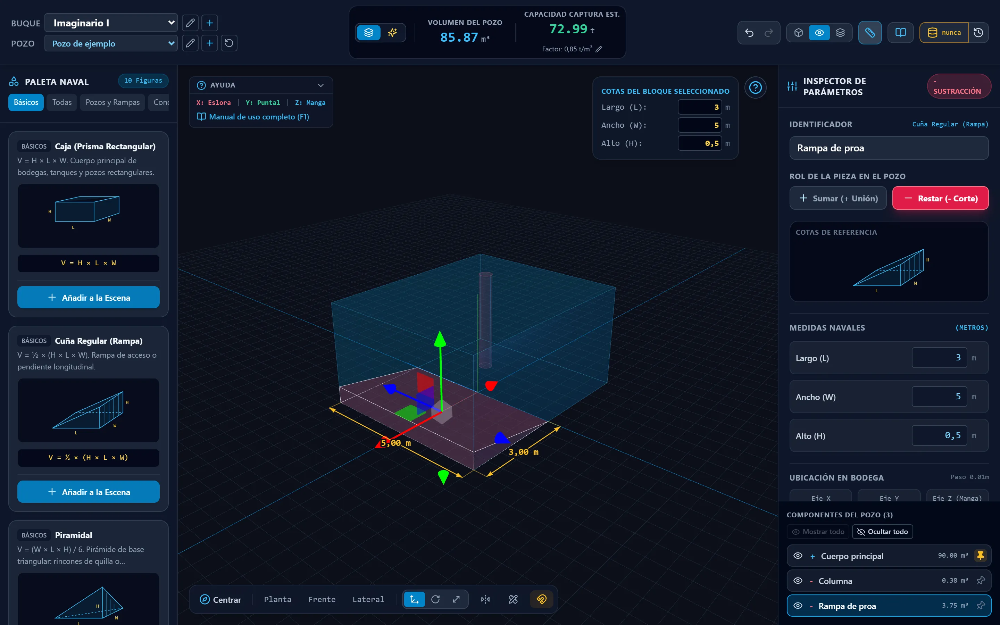

### En tablet y teléfono

El visor ocupa toda la pantalla y abajo aparece una **barra con botones**:

| Botón | Para qué sirve |
| :--- | :--- |
| **Figuras** | Agregar una figura al pozo |
| **Piezas** | Ver la lista de piezas; al tocar una, se abre su edición |
| **Editar** | Cambiar las medidas, la ubicación o el giro de la pieza seleccionada |
| **Deshacer / Rehacer** | Volver atrás o adelante un paso |
| **Más** | Estilo de visualización, cotas, imán, respaldos, instalar, manual y versión |

Los paneles se abren sobre el visor y se cierran con la **✕**. En el teléfono vertical suben desde abajo y dejan ver parte del pozo, así que se puede ver el cambio mientras se edita.

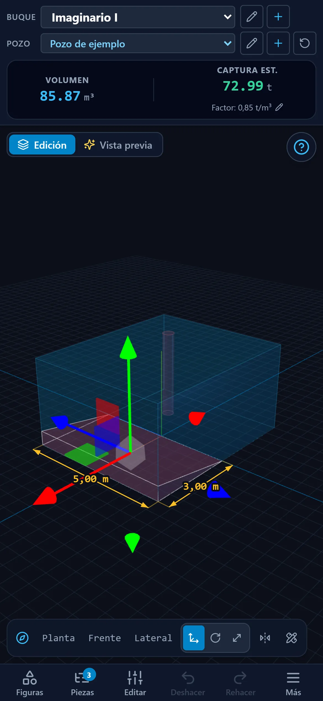

---

## 4. Mirar el pozo: la cámara

Mover la cámara **no cambia el pozo**: solo cambia desde dónde se lo mira.

| Acción | Con mouse | Con el dedo |
| :--- | :--- | :--- |
| Girar alrededor del pozo | Arrastrar con el botón izquierdo | Arrastrar con un dedo |
| Desplazar la vista | Arrastrar con el botón derecho | Arrastrar con dos dedos |
| Acercar o alejar | Rueda del mouse | Pellizcar con dos dedos |
| Seleccionar una pieza | Clic corto sobre ella | Toque corto sobre ella |

Un arrastre **no** cambia la pieza seleccionada: para seleccionar hay que hacer un clic o toque **corto**.

### Vistas rápidas

En la barra flotante de abajo del visor:

- **Centrar** (ícono de brújula): vista en perspectiva desde arriba, del lado de proa y babor.
- **Planta**: desde arriba, como un plano.
- **Frente**: desde proa, mirando hacia popa.
- **Lateral**: desde babor, mirando el largo del pozo.

### Ayuda

El botón redondo **?**, arriba a la derecha del visor, abre este manual desde cualquier pantalla.

Arriba a la izquierda del visor está el panel **Ayuda**, con los controles del mouse y los colores de los ejes. Se pliega o se abre con un clic, y la app recuerda la preferencia.

---

## 5. Buques, pozos y factor de captura

Cada **buque** tiene sus **pozos**, y cada pozo tiene sus **piezas**. Arriba a la izquierda se elige el buque y el pozo con los que se trabaja.

### Botones junto a "Buque" y "Pozo"

| Botón | Acción |
| :---: | :--- |
| **✎** (lápiz) | Editar el buque o el pozo seleccionado. Desde ahí también se **elimina**. |
| **+** | Crear un buque o un pozo nuevo |
| **↺** (solo pozo) | Reiniciar el pozo: quita todas las piezas y deja una caja base |

- Un **buque nuevo** se crea con su "Pozo N° 1".
- Un **pozo nuevo** se crea con una caja de 6 × 4 × 3 m para empezar.
- Al **eliminar**, la app avisa cuántos pozos y piezas se borran y pide confirmación. Antes guarda una copia de seguridad (ver [capítulo 11](#11-guardar-y-respaldar-los-datos)).

### El factor de captura

El factor indica **cuántas toneladas de captura entran en un metro cúbico** de pozo (t/m³). Depende del buque, la especie y la forma de estiba, y se carga **una vez por buque**: vale para todos sus pozos.

Para cambiarlo: **✎** junto al buque, o clic en **"Factor: … t/m³"** debajo de la captura estimada.

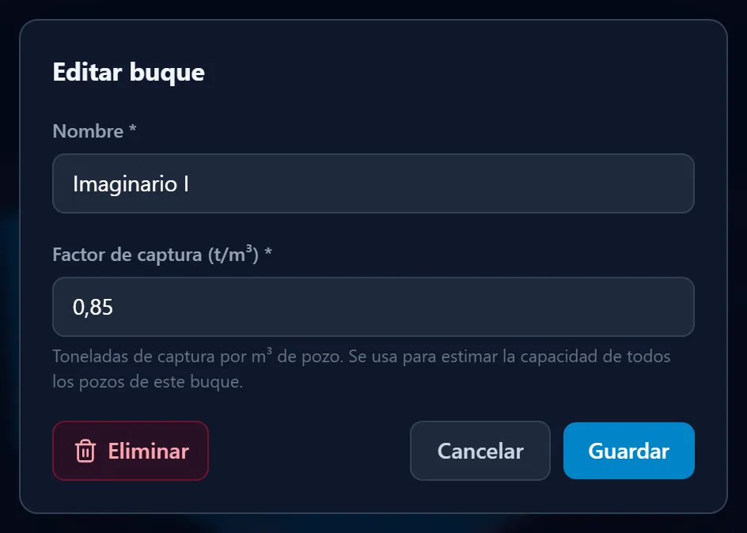

**Cómo obtenerlo a partir de una muestra:**

> Factor (t/m³) = peso de la muestra (t) ÷ volumen de la muestra (m³)

Por ejemplo, si un cajón de 0,05 m³ lleno de pescado pesa 42,5 kg (0,0425 t), el factor es 0,0425 ÷ 0,05 = **0,85 t/m³**.

---

## 6. Las figuras disponibles

En la **Paleta naval** (en tablet y teléfono, en **Figuras**) están las 10 figuras de la ficha técnica, agrupadas por categoría. Cada tarjeta muestra un dibujo con las medidas y la fórmula.

| Figura | Para qué se usa | Medidas que pide |
| :--- | :--- | :--- |
| **Caja (Prisma Rectangular)** | El cuerpo principal del pozo, tanques, cajones | Largo, ancho, alto |
| **Cuña Regular (Rampa)** | Rampas o pendientes del piso, con el mismo ancho en toda su longitud | Largo, ancho, alto |
| **Piramidal** | Rincones triangulares, por ejemplo en la quilla | Largo, ancho, alto y desvío del vértice |
| **Cuña Irregular (Forma Pozo)** | Rampas que se angostan: el ancho de abajo (A) es distinto del de arriba (B) | Largo del piso, altura máxima, ancho bajo (A), ancho alto (B) |
| **Trapezoide (Prisma Trapezoidal)** | Pozos con los costados inclinados (pantoques) | Largo, alto vertical, ancho superior (A), ancho inferior (B) |
| **Trapezoide Cónico (1)** | Pozos de costados inclinados cuya sección cambia de un extremo al otro | Largo, alto vertical, anchos de arriba y abajo en cada extremo (A, B, C, D) |
| **Trapezoide Cónico (2)** | Igual que el anterior, pero el piso termina en punta en un extremo (tolva) | Largo, alto vertical, A, B y C |
| **Cilindro (Columna / Tubería)** | Columnas, puntales y tuberías | Diámetro, longitud o alto |
| **Cilindro Cónico (Tronco de Cono)** | Embudos, escotillas cónicas | Diámetro mayor, diámetro menor, altura |
| **Cilindro Elíptico (Bolsa de Red)** | Copo o bolsa de red | Largo, ancho y alto de la sección |

> **El alto (H) es siempre vertical**: la distancia de arriba a abajo medida a plomo, no a lo largo de una pared inclinada.

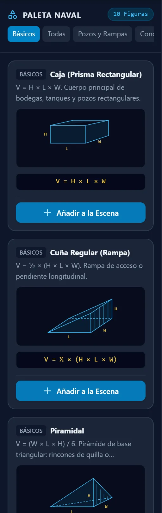

---

## 7. Trabajar con las piezas

### Agregar una pieza

En la paleta, tocá **Añadir a la Escena** (en el teléfono, **Añadir**) en la figura que quieras. La pieza aparece en el visor, **seleccionada** y con medidas de ejemplo para que después las ajustes.

### Seleccionar una pieza

- Clic o toque corto sobre la pieza en el visor, o
- en la lista **Componentes del pozo** (en tablet y teléfono, en **Piezas**).

La pieza seleccionada se ve más clara y con un recuadro amarillo alrededor.

### El inspector: todo lo de una pieza

En el **Inspector de parámetros** (en tablet y teléfono, en **Editar**):

1. **Identificador:** el nombre de la pieza. Conviene ponerle un nombre claro, como "Columna de babor".
2. **Rol de la pieza en el pozo:**
   - **Sumar (+ Unión):** forma parte del pozo. Se ve azul.
   - **Restar (− Corte):** quita espacio. Se ve roja y semitransparente.
3. **Cotas de referencia:** el dibujo de la figura, con el significado de cada letra.
4. **Medidas navales (metros):** las medidas de la figura.
5. **Ubicación en bodega:** dónde está la pieza (ver abajo).
6. **Orientación y giro:** cuánto está girada, en grados, y los botones de **Espejo**.
7. **Volumen calculado:** la fórmula con los números de la pieza y su volumen individual.
8. **Duplicar** y **Eliminar**.

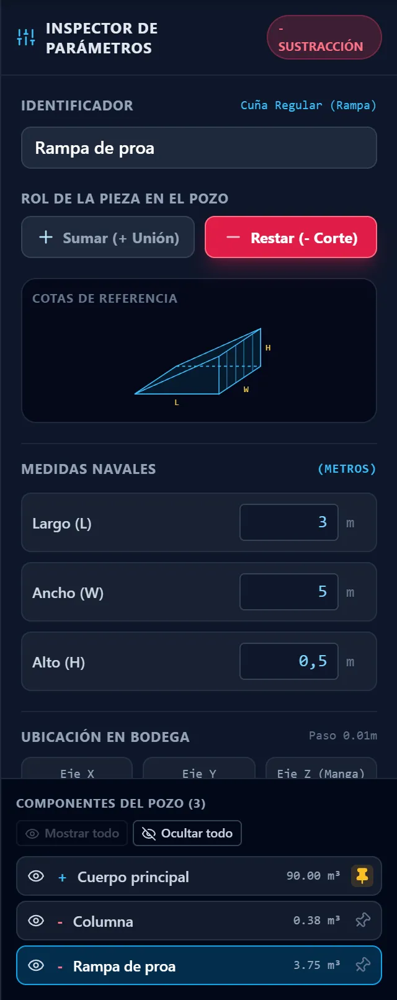

Si escribís un valor inválido (vacío, letras o una medida menor al mínimo), el campo se pone **rojo** y no se aplica. Al salir del campo vuelve el último valor válido.

### Ubicación: qué significan X, Y y Z

| Campo | Qué indica |
| :--- | :--- |
| **Eje X (Eslora)** | Dónde está el **centro** de la pieza a lo largo del buque |
| **Eje Y (Puntal)** | A qué altura está el **piso** de la pieza (0 = apoyada en el piso de la cuadrícula) |
| **Eje Z (Manga)** | Dónde está el **centro** de la pieza a lo ancho del buque |

Ejemplo: una caja de 6 m de largo con X = 0 va de −3 a +3 en la eslora. Con X = 4, va de 1 a 7.

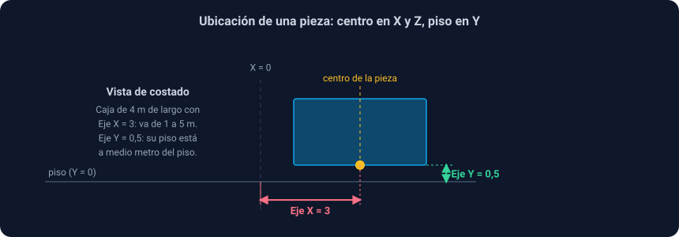

### Orientación y giro

- **Giro Y (Planta):** gira la pieza vista desde arriba. 90° la pone "atravesada".
- **Giro X** y **Giro Z:** la inclinan hacia los costados o hacia adelante.
- **+90° Piso** y **+90° Frente** giran de a 90°. **0°** vuelve la pieza a su posición original.

> La **Cuña Regular** se agrega girada 180° en planta, con el borde fino (el "filo") hacia proa. Si la necesitás al revés, tocá **0°**.

### Mover, rotar y estirar en el visor

En la barra flotante de abajo del visor hay tres modos:

| Modo | Tecla | Qué hace |
| :--- | :---: | :--- |
| **Mover** | W | Aparecen tres flechas (rojo = eslora, verde = altura, azul = manga). Arrastrar una flecha mueve la pieza en esa dirección. |
| **Rotar** | R | Aparecen anillos. Arrastrar un anillo gira la pieza de a 15°. |
| **Estirar** | S | Aparecen **puntos amarillos** sobre las caras. Arrastrar uno cambia una medida, sin cambiar el tipo de figura. |

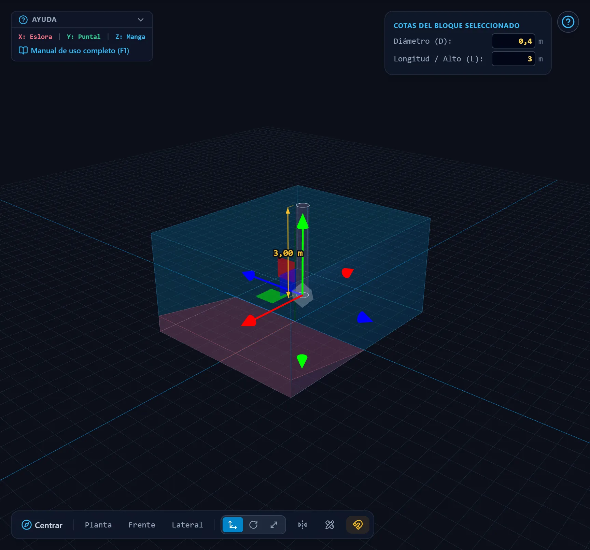

**Modo Estirar en detalle:**
- Mientras arrastrás, se ve la medida en un cartel amarillo.
- La **cara opuesta queda quieta**. Por ejemplo, en una cuña, si estirás el lado de la cara vertical, el filo no se mueve.
- Funciona con la caja, la cuña regular, la piramidal, el cilindro, el cilindro cónico y el cilindro elíptico. Los trapezoides y la cuña irregular se ajustan escribiendo las medidas.
- En los cilindros, el diámetro crece hacia todos los lados.

### El vértice de la Piramidal

La piramidal tiene una base triangular y un **vértice** (la punta). Al agregarla, la punta está justo encima de la esquina de la base, pero se puede **correr en paralelo a la base** para adaptarla a la forma del pozo:

- En el modo **Estirar**, arrastrá el **punto verde** de la punta. Se mueve en una sola dirección por vez: la que más se parezca a tu movimiento. El punto amarillo que está un poco más allá cambia el alto.
- O escribí **Desvío vértice en L** y **Desvío vértice en W** (en metros) en el inspector o en la ventana de cotas. Un valor negativo corre la punta hacia el otro lado, y 0 la deja sobre la esquina.

**El volumen no cambia** al correr la punta: sigue siendo largo × ancho × alto ÷ 6, porque la punta se mantiene a la misma distancia de la base. Sí puede cambiar el volumen **del pozo**, si la nueva forma ocupa otro lugar respecto de las demás piezas.

> Si la pieza está acostada o girada, el «Alto (H)» puede quedar horizontal: es la distancia de la base a la punta.

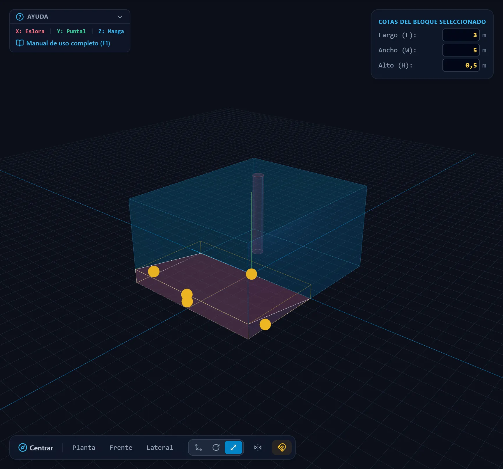

### Espejo

**Espejo** invierte la pieza seleccionada, como si se la viera en un espejo, **sin moverla de lugar**. Sirve, por ejemplo, para dar vuelta una rampa o pasar una pieza armada para babor a estribor.

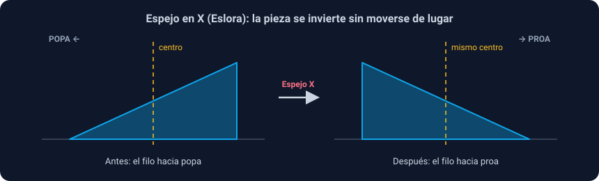

1. Seleccioná la pieza.
2. Tocá **Espejo** en la barra flotante de abajo del visor (o la tecla **M**).
3. Elegí el eje:

| Botón | Qué invierte |
| :--- | :--- |
| **X Eslora** | Proa con popa. En una cuña, el filo pasa al otro extremo. |
| **Y Puntal** | Arriba con abajo. La pieza queda "boca abajo". |
| **Z Manga** | Babor con estribor |

Con el panel abierto, también funcionan las teclas **X**, **Y** y **Z**. Los mismos botones están en el inspector, en **Orientación y giro**.

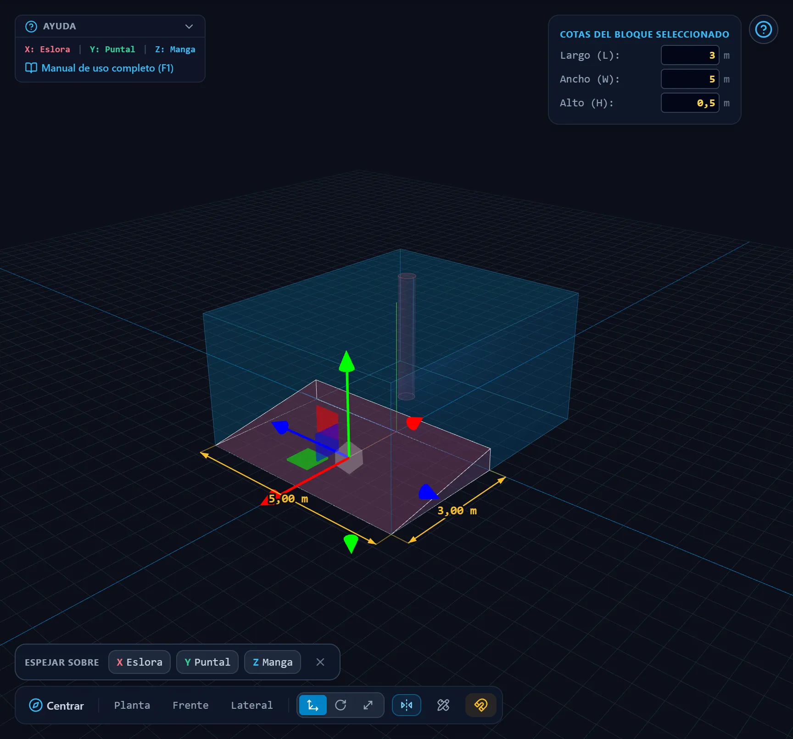

- Las medidas y el volumen de la pieza no cambian. Solo cambian sus giros (y, en la **Piramidal**, se intercambian el largo y el ancho, junto con sus desvíos, porque así se arma su reflejo).
- Espejar dos veces sobre el mismo eje deja la pieza como estaba. También se puede **deshacer**.
- Para tener la pieza **en los dos costados**, primero **Duplicala** y después espejá la copia y cambiá su ubicación.
- Una pieza **fijada** no se puede espejar.

### El imán

El botón del **imán** (al final de la barra flotante) ayuda a acomodar las piezas sin escribir números:

- La pieza avanza de a **0,25 m** sobre la cuadrícula.
- Al acercar una pieza (moviendo o estirando) a otra **cercana**, se **pega** a su cara y esa cara se **resalta en verde**.

Para ubicar una pieza con precisión de centímetros, apagá el imán o escribí los valores en el inspector.

> El imán usa el "contorno" rectangular de cada pieza. Con caras inclinadas o piezas giradas en ángulos que no son de 90°, puede quedar un pequeño hueco: en ese caso, ajustá los valores a mano.

### Cotas: ver las medidas sobre el dibujo

Las **cotas** son líneas con flechas que muestran cuánto mide cada cosa, como en un plano. Se muestran u ocultan con el botón de la **regla** de la barra superior (en tablet y teléfono, **Más → Cotas y medidas en el visor**). La app recuerda tu elección.

La app las dibuja sola:

- En **Edición**: largo, ancho y alto de la **pieza seleccionada**.
- En **Vista previa**: las medidas del **pozo terminado**. Las líneas de color más intenso son las medidas totales; las más claras, las **parciales** entre quiebres (por ejemplo, dónde empieza a cerrarse el fondo).

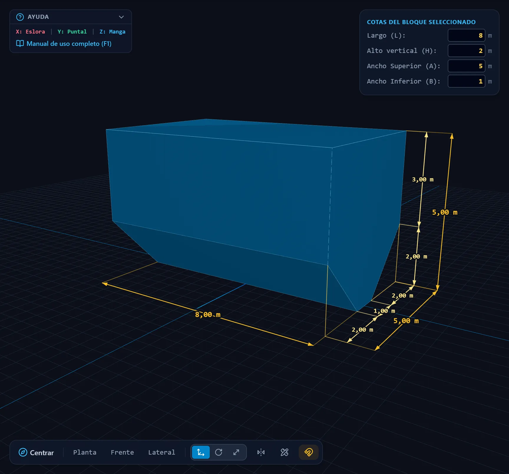

Las cotas se acomodan del lado que estás mirando. Si una medida no entra en la pantalla porque quedó muy chica o de punta, no se dibuja: acercá o girá la vista. Cuando un eje tiene muchos quiebres, se muestra solo el total para que no se amontonen.

Con las cotas a la vista, en computadora y tablet también aparece arriba a la derecha la ventana **Cotas del bloque seleccionado**, donde se pueden editar las medidas de la pieza.

### Medir: poner tus propias cotas

Para acotar justo lo que querés, tocá **Medir** (ícono de regla y lápiz en la barra flotante, o tecla **D**):

1. Elegí qué medir: **Directa** (la línea recta entre los dos puntos), **Eslora** (solo a lo largo), **Puntal** (solo en altura) o **Manga** (solo a lo ancho).
2. Tocá el **primer punto** y después el **segundo**. El punto se engancha solo a las **esquinas** y **aristas** cercanas; un círculo blanco muestra dónde.
3. La cota queda dibujada en verde y anotada en la lista del panel (en el teléfono, tocá **Cotas** para verla).

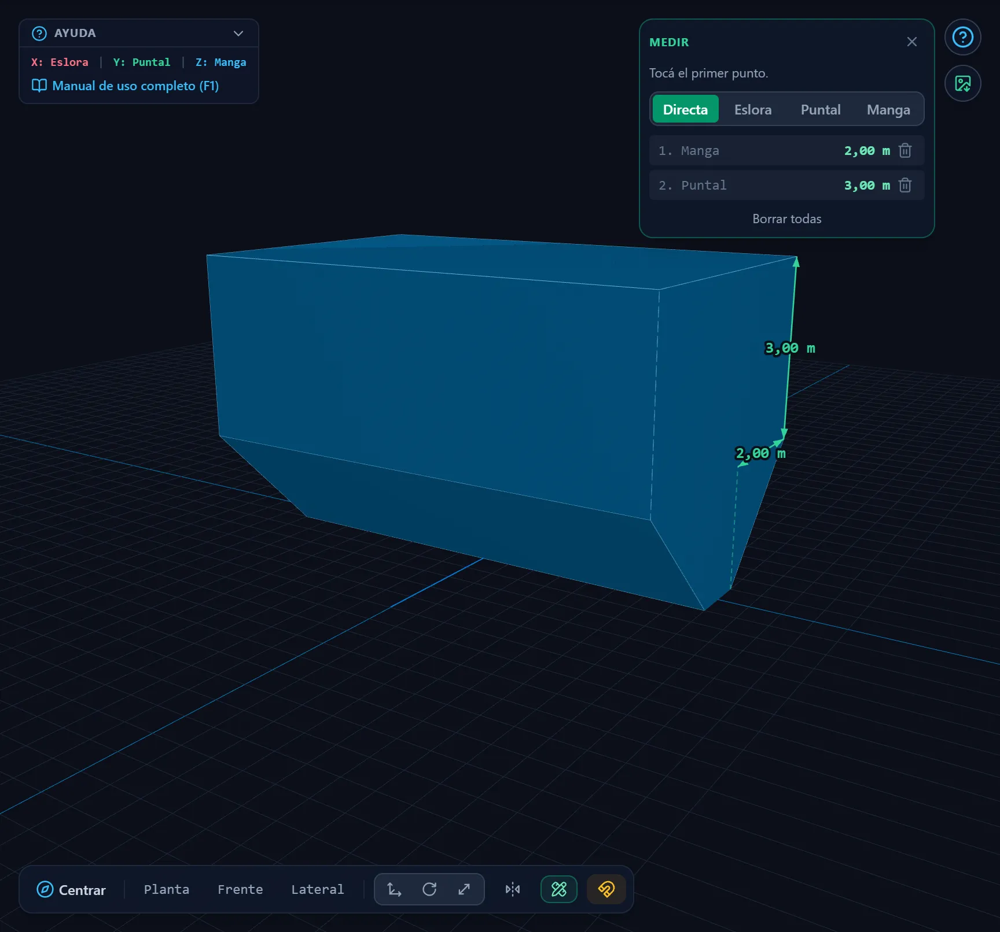

Se salen con **Esc** o con la **×**. Para borrar una cota usá el tacho de la lista, o **Borrar todas**.

> Las cotas puestas a mano se guardan con el pozo, pero **no siguen a las piezas**: si después movés o cambiás una pieza, borrá la cota y medí de nuevo. Borrarlas no se puede deshacer.

### La lista de piezas

En **Componentes del pozo** (en tablet y teléfono, en **Piezas**) están todas las piezas, con su rol (**+** o **−**) y su volumen individual. En cada fila hay dos botones:

| Botón | Para qué sirve |
| :---: | :--- |
| **Ojo** | **Ocultar o mostrar** la pieza en el visor, para ver lo que tapa. Es solo visual: una pieza oculta **sigue contando** en el volumen. |
| **Pin** | **Fijar** la pieza: ya no se puede mover, girar ni cambiar sus medidas. Útil para no arruinar por accidente el cuerpo principal una vez medido. Se puede renombrar, duplicar o eliminar. |

Arriba de la lista están **Mostrar todo** y **Ocultar todo**.

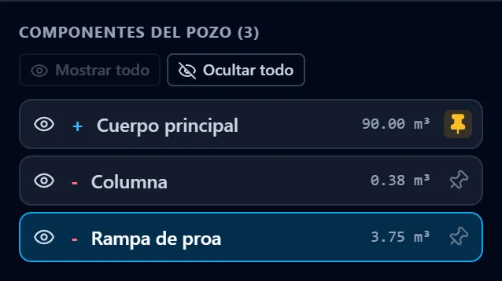

### Duplicar y eliminar

- **Duplicar** crea una copia al lado, con las mismas medidas. Sirve para piezas repetidas, como dos columnas iguales. La copia nace sin fijar.
- **Eliminar** (o la tecla **Supr**) borra la pieza, previa confirmación. Se puede deshacer.

---

## 8. Ejemplo guiado: un pozo completo

Vamos a modelar un pozo de **6 m de largo, 5 m de ancho y 3 m de alto**, con:

- una **columna** de 0,40 m de diámetro, y
- una **rampa en el piso** del lado de proa, que sube 0,50 m a lo largo de 3 m.

Al final, el volumen debe dar **85,87 m³**.

### Paso 1: crear el pozo

1. Elegí el buque **Imaginario I** (o el tuyo).
2. Tocá **+** junto a **Pozo**, escribí "Pozo de ejemplo" y tocá **Crear pozo**.
3. Aparece una caja de 6 × 4 × 3 m. El volumen dice **72,00 m³**.

### Paso 2: ajustar el cuerpo principal

1. Seleccioná la caja (es la única pieza).
2. En **Identificador**, escribí "Cuerpo principal".
3. En **Medidas navales**, cambiá **Ancho (W)** a **5**.
4. El volumen pasa a **90,00 m³** (6 × 5 × 3).
5. Fijala con el **pin** en la lista de piezas, para no moverla sin querer.

### Paso 3: restar la columna

1. En la paleta, agregá un **Cilindro (Columna / Tubería)**.
2. Nombre: "Columna".
3. **Rol:** tocá **Restar (− Corte)**. La pieza se pone roja.
4. **Medidas:** Diámetro (D) = **0,4**; Longitud / Alto (L) = **3**.
5. **Ubicación:** Eje X = **−1,5**; Eje Y = **0**; Eje Z = **1**.
6. El volumen pasa a **89,62 m³**: se descontaron 0,377 m³, el volumen de la columna.

### Paso 4: restar la rampa del piso

1. Agregá una **Cuña Regular (Rampa)**.
2. Nombre: "Rampa de proa".
3. **Rol:** **Restar (− Corte)**.
4. **Medidas:** Largo (L) = **3**; Ancho (W) = **5**; Alto (H) = **0,5**.
5. **Ubicación:** Eje X = **1,5**; Eje Y = **0**; Eje Z = **0**. Así la rampa ocupa desde el centro del pozo (X = 0) hasta la pared de proa (X = 3).
6. **Giro:** tocá **0°**, para que la parte alta de la rampa quede contra la pared de proa.
7. El volumen pasa a **85,87 m³**: se descontaron 3,75 m³ de la rampa (½ × 0,5 × 3 × 5).

### Paso 5: revisar el resultado

1. Tocá **Vista previa**: se ve el pozo final, con la columna y la rampa recortadas.
2. Con un factor de captura de 0,85 t/m³, la **captura estimada** es **72,99 t** (85,87 × 0,85).
3. Volvé a **Edición** para seguir trabajando.

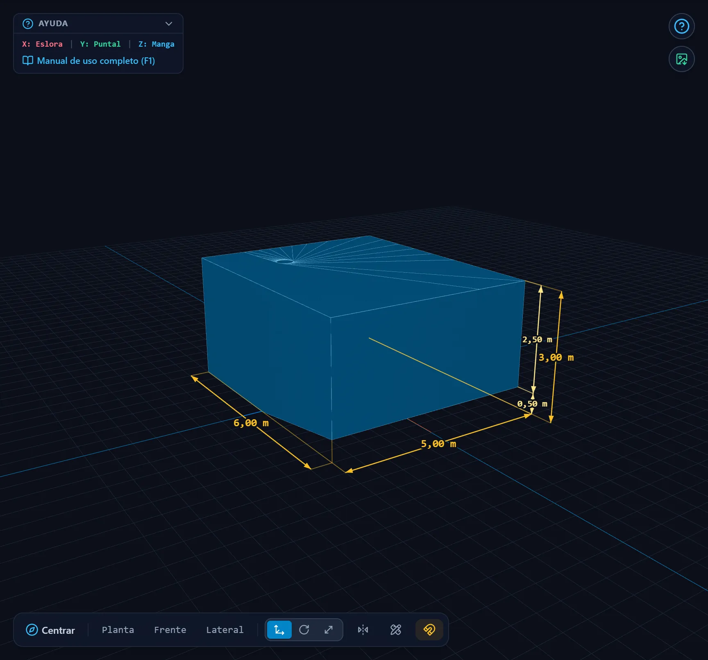

### Guardar la vista como imagen

En **Vista previa**, debajo del botón **?** aparece el botón de **Exportar imagen** (verde, con una flecha hacia abajo). La app pregunta el fondo y descarga un archivo **PNG**:

- **Fondo claro:** blanco con trazos oscuros, para imprimir o pegar en un informe.
- **Fondo oscuro:** con los mismos colores que la pantalla.

La imagen sale **como la estás viendo**: la misma cámara y zoom, el mismo estilo (Sólido, Rayos X o Alambre) y las cotas que estén a la vista, incluidas las que pusiste con **Medir**. No salen los paneles ni los botones. Antes de exportar, acomodá la vista; si no querés cotas, ocultalas con la regla.

El archivo lleva el nombre del buque, del pozo y la fecha, y queda en la carpeta de descargas del dispositivo.

---

## 9. Leer el resultado

En el centro de la barra superior:

- **Volumen del pozo:** el volumen real del sólido, en m³.
- **Captura estimada:** volumen × factor, en toneladas. Debajo se ve el factor usado.

Al lado del título del volumen puede aparecer una etiqueta:

| Etiqueta | Qué significa |
| :--- | :--- |
| (ninguna) | El cálculo está al día |
| **Calculando…** | Está recalculando después de un cambio. Tarda un instante; en pozos con muchas piezas, un poco más. |
| **⚠ Aproximado** | No se pudo calcular el sólido. El número es una suma simple de las fórmulas, sin tener en cuenta superposiciones. Revisá las piezas antes de usar el valor. |

### Edición y Vista previa

- **Edición:** cada pieza se ve por separado, para seleccionarla y modificarla.
- **Vista previa:** se ve el pozo final como un único sólido, con los recortes aplicados. Sirve para comprobar que el modelo es el que esperabas. En este modo no se editan piezas.

### Estilos de visualización

| Estilo | Para qué sirve |
| :--- | :--- |
| **Sólido** | Vista normal |
| **Rayos X** | Piezas transparentes, para ver lo que queda adentro |
| **Alambre** | Solo las aristas, para ver la estructura |

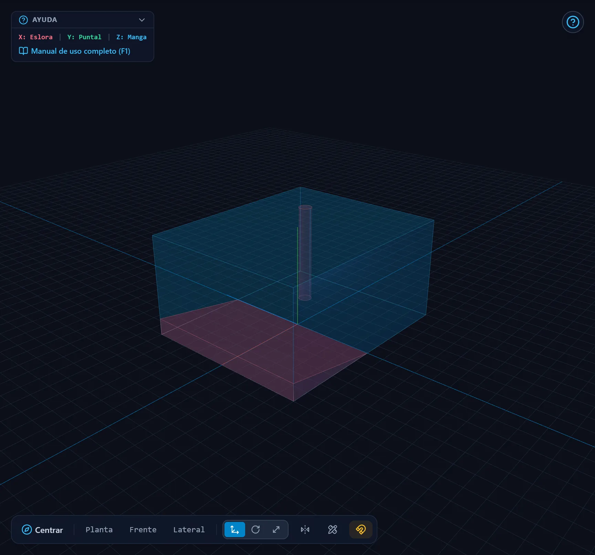

---

## 10. Deshacer y atajos de teclado

Casi todo se puede **deshacer**: agregar, borrar, mover, cambiar medidas, fijar… Los botones están en la barra superior (en tablet y teléfono, en la barra de abajo). La app recuerda los últimos 50 pasos del pozo abierto. Eliminar un buque o un pozo **no** se deshace: para eso están las copias de seguridad.

| Tecla | Acción |
| :---: | :--- |
| **Ctrl + Z** | Deshacer |
| **Ctrl + Y** o **Ctrl + Shift + Z** | Rehacer |
| **W** | Modo Mover |
| **R** | Modo Rotar |
| **S** | Modo Estirar |
| **M** | Abrir o cerrar Espejo; después, **X**, **Y** o **Z** eligen el eje |
| **D** | Abrir o cerrar Medir (**Esc** descarta el punto elegido o sale) |
| **Espacio** | Alternar entre Mover y Rotar |
| **Supr** | Eliminar la pieza seleccionada |
| **F1** | Abrir este manual |
| **Enter** / **Esc** | Confirmar / cancelar en los diálogos y salir de un campo |

En Mac, usá **Cmd** en lugar de **Ctrl**. Los atajos no actúan mientras se escribe en un campo.

---

## 11. Guardar y respaldar los datos

### Guardado automático

**No hay botón de guardar**: cada cambio se guarda solo, en el mismo dispositivo.

### Por qué hacer respaldos

Los datos viven en el navegador de ese dispositivo. Si se borran los datos del navegador, se pierde o se rompe el equipo, también se pierden. La única protección real es **exportar un archivo de respaldo** y guardarlo en otro lugar (un pendrive, el correo, una carpeta compartida).

### Exportar un respaldo

- En computadora: botón **Respaldar DB** (ícono de base de datos) en la barra superior.
- En tablet y teléfono: **Más → Exportar .sqlite**.

Se descarga un archivo `.sqlite` con **todos** los buques, pozos y piezas. Si pasan más de 7 días sin exportar, el botón se pone **ámbar** como recordatorio.

### Recuperar un respaldo o pasar los datos a otro equipo

En el menú de respaldos (ícono de reloj junto a **Respaldar DB**, o **Más** en tablet y teléfono), tocá **Importar .sqlite** y elegí el archivo.

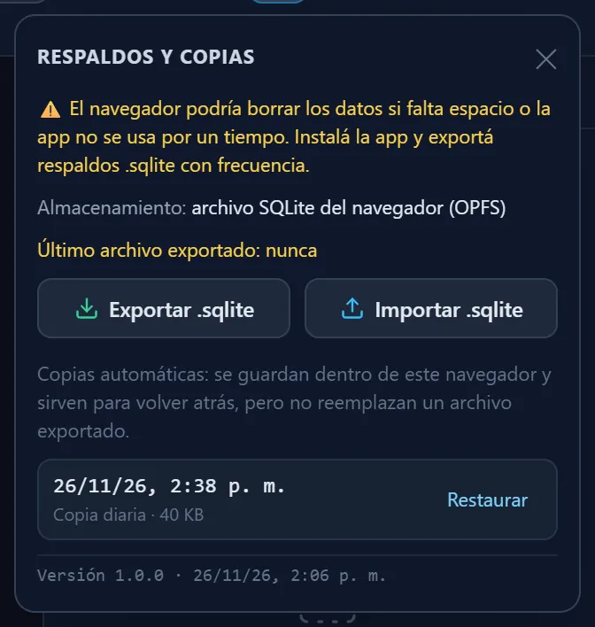

> **Importar reemplaza todos los datos actuales** por los del archivo. Antes, la app guarda una copia de los datos actuales, por si te equivocás.

### Copias automáticas

La app guarda sola una copia **por día** y otra **antes de cada cambio importante** (eliminar, importar o restaurar). Se ven en el mismo menú, con fecha y motivo, y se recuperan con **Restaurar**. Son útiles para volver atrás, pero viven en el mismo navegador: **no reemplazan** un archivo exportado.

---

## 12. Consejos para medir y modelar

- **Elegí una referencia fija** y usala siempre: por ejemplo, X = 0 en el centro del pozo, Y = 0 en el piso y Z = 0 en la línea de crujía (el centro del buque).
- **Empezá por el cuerpo principal** (la caja más grande que represente el pozo) y fijalo con el pin.
- **Agregá después lo que falta** (pantoques, rampas) con piezas que **suman**, y **lo que sobra** (columnas, tuberías, cajones) con piezas que **restan**.
- **Superponer piezas no es un error:** la parte compartida se cuenta una sola vez. A veces es más fácil modelar con piezas que se superponen que ajustarlas al centímetro.
- **Una pieza que resta y queda fuera del pozo no descuenta nada.** Si el volumen no baja, revisá su ubicación con **Rayos X** o **Vista previa**.
- **Nombrá las piezas** con su función ("Columna babor", "Rampa proa"): así la lista se entiende de un vistazo.
- **Medí el alto siempre a plomo**, no sobre una pared inclinada.
- **Comprobá con Vista previa** antes de dar el volumen por bueno.
- **Exportá un respaldo** al terminar cada pozo.

---

## 13. Problemas frecuentes

**No puedo mover ni cambiar las medidas de una pieza.**
Está **fijada**: el pin de su fila en la lista está en ámbar. Tocá el pin para liberarla.

**No veo una pieza.**
Puede estar **oculta** (el ojo de su fila aparece tachado): tocá el ojo o **Mostrar todo**. También puede estar lejos o adentro de otra: probá **Centrar** o el estilo **Rayos X**.

**Agregué una pieza que resta pero el volumen no bajó.**
Está fuera del pozo, o recorta una zona que otra pieza que resta ya había quitado. Revisá su ubicación con **Vista previa**.

**El volumen dice "⚠ Aproximado".**
El cálculo 3D falló, por ejemplo por una pieza con medidas extremas. Revisá las últimas piezas que cambiaste o deshacé el último paso.

**Al escribir un número, el campo se puso rojo.**
El valor no es válido: está vacío, tiene letras o es menor al mínimo. Corregilo o salí del campo para volver al valor anterior.

**No aparecen los puntos amarillos en el modo Estirar.**
La pieza está fijada, o es un trapezoide o una cuña irregular, que todavía no se pueden estirar: cambiá sus medidas en el inspector.

**Dice "La aplicación ya está abierta en otra pestaña".**
Cerrá la otra pestaña, o tocá **Usar en esta pestaña**.

**Aparece "El navegador podría borrar los datos…".**
El navegador no garantiza conservar los datos. Instalá la app y exportá respaldos con frecuencia.

**Borré algo por error.**
Si fue una pieza, usá **Deshacer**. Si fue un buque o un pozo, recuperalo desde las **copias automáticas** (menú de respaldos → **Restaurar**).

---

## 14. Glosario

| Término | Significado |
| :--- | :--- |
| **Babor / Estribor** | Costado izquierdo / derecho del buque, mirando hacia proa |
| **Proa / Popa** | Parte delantera / trasera del buque |
| **Eslora** | Largo, en la dirección proa-popa (eje X) |
| **Manga** | Ancho, de babor a estribor (eje Z) |
| **Puntal** | Altura (eje Y) |
| **Crujía** | Línea central del buque, de proa a popa |
| **Pantoque** | Zona curva o inclinada donde el fondo se une con los costados |
| **Cubicación** | Cálculo del volumen de un espacio |
| **Factor de captura** | Toneladas de captura por metro cúbico de pozo (t/m³) |
| **Pieza** | Cada figura que forma el modelo del pozo |
| **Sumar / Restar** | Rol de una pieza: agrega espacio al pozo o lo quita |
| **Fijar** | Proteger una pieza para que no se mueva ni cambie de medidas |
| **Espejo** | Invertir una pieza sobre un eje, sin moverla de lugar |
| **Cota** | Línea con flechas que muestra una medida sobre el dibujo |
| **Imán** | Ayuda que acomoda las piezas en la cuadrícula y las pega a otras cercanas |
| **Vista previa** | Modo que muestra el pozo final como un único sólido |
| **Respaldo (.sqlite)** | Archivo con todos los datos, para guardar o pasar a otro equipo |
